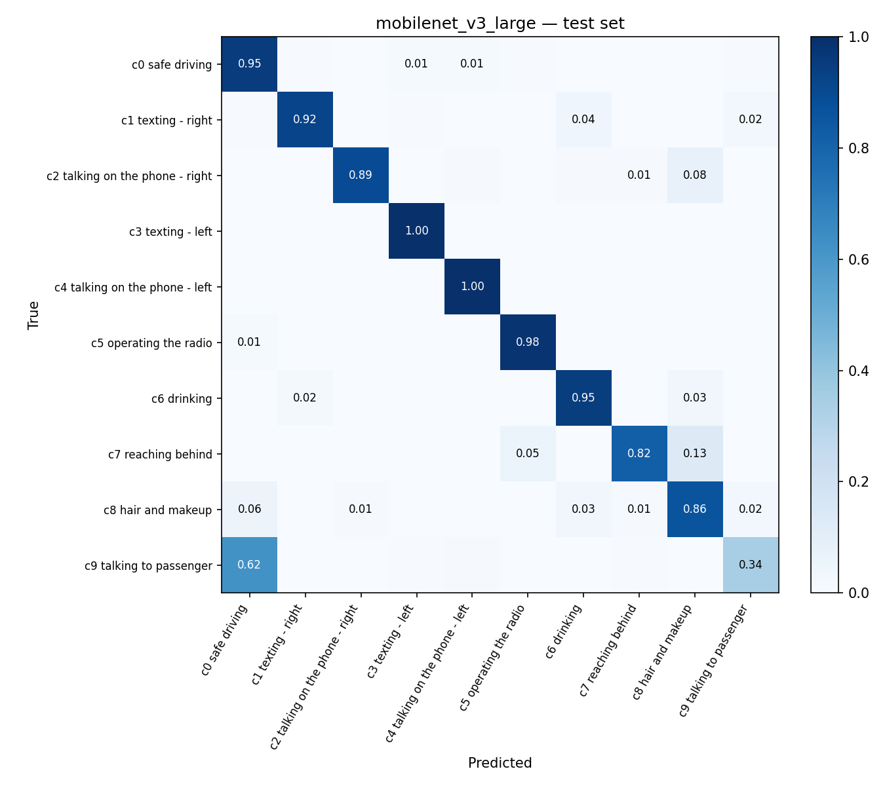
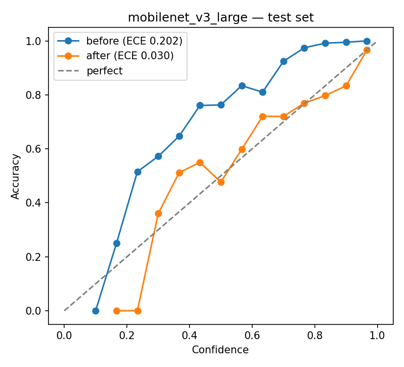
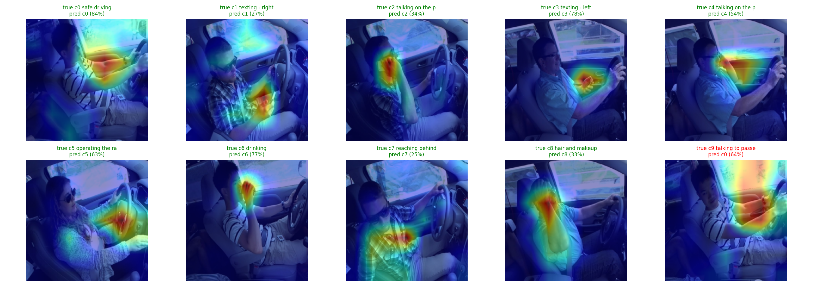

# 🚗 Driver Monitoring System

Real-time detection of **distracted** and **drowsy** driving from a single camera. A deep-learning activity classifier and a face-landmark drowsiness module are fused into one driver state, with escalating audio alerts. Everything runs live on a laptop CPU at about 15 FPS.


| | |
|---|---|
| **Distraction** | 10-class activity classifier (MobileNetV3-Large) → **87.6% accuracy on drivers never seen in training** |
| **Drowsiness** | Eye closure (EAR), PERCLOS, microsleeps, yawns, head nods, eyes off road, all with per-driver calibration |
| **Fusion** | 🟢 Attentive → 🟡 Distracted → 🟠 Drowsy → 🔴 Critical, with chime / beep + spoken warning / alarm |
| **Deployment** | ONNX Runtime (2.7× faster than PyTorch), FastAPI service, Dockerfile, trip summaries |

---

## Contents
- [How it works](#how-it-works)
- [Results](#results)
- [Key engineering decisions](#key-engineering-decisions)
- [Drowsiness and gaze signals](#drowsiness-and-gaze-signals)
- [Project structure](#project-structure)
- [Getting started](#getting-started)
- [Limitations](#limitations)
- [Future work](#future-work)

---

## How it works

```mermaid
flowchart LR
    CAM[Webcam frame] --> CLS[Distraction classifier<br/>MobileNetV3 · ONNX<br/>every 2nd frame]
    CAM --> FACE[MediaPipe Face Landmarker<br/>478 landmarks + head pose<br/>every frame]
    CLS --> SMOOTH[Temporal smoothing<br/>P&#40;distracted&#41; ≥ 0.7 for 2 s]
    FACE --> DROWSY[Drowsiness and gaze detector<br/>EAR · PERCLOS · yawns · nods · eyes off road]
    SMOOTH --> ENGINE{Driver state engine}
    DROWSY --> ENGINE
    ENGINE --> UI[Live display]
    ENGINE --> ALERTS[Escalating alerts]
    ENGINE --> LOG[Trip log and summary]
```



1. **Distraction classifier:** MobileNetV3-Large, fine-tuned from ImageNet on the [State Farm Distracted Driver Detection](https://www.kaggle.com/competitions/state-farm-distracted-driver-detection) dataset (22,424 images, 26 drivers, 10 classes). Its outputs are calibrated with temperature scaling and averaged over 1 second.
2. **Drowsiness and gaze module:** MediaPipe face landmarks give eye openness, mouth opening, and head pose. Thresholds are set relative to *each driver's own baseline*, recorded during a 15-second calibration.
3. **Driver state engine:** combines both signals. Single-frame errors and quick glances never trigger an alert; behaviors must be sustained.

| Distraction | Drowsiness | State |
|---|---|---|
| Safe | Alert | 🟢 ATTENTIVE |
| Phone, drinking, etc. ≥ 2 s, or eyes off road ≥ 2 s | Alert | 🟡 DISTRACTED |
| Safe | PERCLOS ≥ 15%, ≥ 3 yawns, or ≥ 2 nods | 🟠 DROWSY |
| Distracted | Drowsy | 🔴 CRITICAL |
| any | Eyes closed ≥ 1.5 s (microsleep) | 🔴 CRITICAL |

**Alerts escalate:** a soft chime when distracted, a beep plus the spoken warning *"You seem tired. Please take a break."* when drowsy, and a continuous alarm when critical. Alarms stop the moment the driver is attentive again. Cooldowns prevent alert fatigue.

---

## Results

All numbers are on a **held-out test set of 4 drivers** who were never used for training or for choosing between models.

### Model comparison

| Model | Params | Test accuracy | Macro-F1 | Distraction recall | False-alarm rate* |
|---|---|---|---|---|---|
| Baseline CNN (from scratch) | 1.2 M | 82.4% | 0.820 | 95.3% | 29.9% |
| EfficientNet-B0 | 4.0 M | 88.6% | 0.876 | 93.7% | 16.7% |
| **MobileNetV3-Large** ✅ | 4.2 M | **87.6%** | **0.866** | 92.7% | **10.1%** |

\* Share of safe-driving frames flagged as distracted, *per frame*. In the live system, temporal smoothing (≥ 70% confidence sustained for 2 s) suppresses most isolated false alarms.

**MobileNetV3 was chosen on the validation set** (macro-F1 0.880 vs 0.844). EfficientNet scored about 1 point higher on test, but switching to it after seeing test results would turn the test set into a second validation set. MobileNetV3 also has the lowest false-alarm rate and needs roughly half the computation per image.

### Per-driver test accuracy
| p002 | p021 | p039 | p052 |
|---|---|---|---|
| 85.1% | 85.5% | 83.4% | 97.2% |

Three of four unseen drivers fall within 83–86%, so the result isn't carried by one easy driver. The spread also shows why small validation and test sets (4 drivers each) are noisy.

### Error analysis


| Class | Recall | Note |
|---|---|---|
| Texting / phone, left hand | 99.7% | Clear, distinctive arm position |
| Operating the radio | 98.2% | |
| Safe driving | 95.1% | |
| **Talking to passenger** | **34.5%** | **62% predicted as safe driving** |

The main weakness is **c9, talking to passenger**. The driver's hands are on the wheel and only the **head is turned**, so in a single still image it looks almost identical to safe driving. Rather than relying on the image classifier alone, the system adds a **head-pose signal** from the face-landmark module: a head turned beyond the driver's baseline for 2 seconds is flagged as *eyes off road*, regardless of what the classifier predicts.

Other confusions are visually plausible: *reaching behind → hair and makeup* (13%, arm raised near the head) and *phone right → hair and makeup* (8%, hand at the side of the head).

### Calibration


Label smoothing during training left the model **underconfident**: when it said 45%, it was right about 76% of the time. Temperature scaling, fitted on the validation drivers only, reduced the expected calibration error from **0.202 to 0.030** on the test set. Calibrated probabilities make the alert threshold ("P(distracted) ≥ 0.7") mean what it says.

### Explainability


Grad-CAM heatmaps show which image regions drive each prediction, one example per class. The evaluation notebook also renders the most confident mistakes.

### Deployment speed (CPU, one image at a time)

| Variant | Accuracy | Latency | Throughput | Size |
|---|---|---|---|---|
| PyTorch FP32 | 87.6% | 30.9 ms | 32 FPS | 17.1 MB |
| **ONNX Runtime FP32** ✅ | **87.6%** | **11.5 ms** | **87 FPS** | 16.9 MB |
| ONNX Runtime INT8 (static) | 77.8% | 13.4 ms | 75 FPS | 4.7 MB |

Measured on a 2-core Colab CPU. **ONNX Runtime is 2.7× faster than PyTorch with identical predictions.** INT8 static quantization shrank the model 3.6× but **cost 9.8 accuracy points** (MobileNetV3's hard-swish and squeeze-excitation layers are known to quantize poorly) and gave no speed gain on this CPU, so **FP32 ONNX is deployed**. The full live pipeline (MediaPipe on every frame + classifier on every 2nd frame + display) runs at **about 15 FPS** on an HP Envy x360 laptop with an Intel Core 7 CPU.

---

## Key engineering decisions

| Decision | Why |
|---|---|
| **Driver-wise train/val/test split** (18/4/4 drivers) | Frames of one driver are near-duplicates. A random image-level split leaks drivers into the test set and inflates accuracy to about 99%. Splitting by driver measures performance on *new people*. A test checks that no driver appears in two splits. |
| **No horizontal-flip augmentation** | Flipping turns "texting – right" into "texting – left" and corrupts the labels |
| **Two-phase fine-tuning** | Train the new head with the backbone frozen, then fine-tune everything at a lower learning rate |
| **Early stopping on validation loss** | All three models peaked at epoch 5 and then started to overfit (train accuracy > 99%) |
| **Model choice and calibration fitted on validation only** | Keeps the test numbers unbiased |
| **One preprocessing definition** | Laptop preprocessing (NumPy + Pillow) is verified numerically against the training transform, and ONNX outputs against PyTorch |
| **Per-driver calibration** | Eye shape and camera position vary. Thresholds are relative to each driver's own 15-second baseline, not fixed values |
| **Blinks excluded from PERCLOS** | Only closures ≥ 0.4 s count, so screen-tired, frequently blinking eyes aren't mistaken for drowsiness. Eye squints during yawns are also ignored |
| **Time-based rules** | Every rule is in seconds, not frames, so behavior is the same at 10 or 30 FPS |
| **Resumable training** | Atomic checkpoints to Google Drive every epoch; a Colab disconnect costs minutes, not the run |

---

## Drowsiness and gaze signals

| Signal | Measurement | Triggers |
|---|---|---|
| Eye closure | Eye aspect ratio (EAR) < 70% of your open-eye baseline | — |
| Microsleep | Eyes closed continuously ≥ 1.5 s | 🔴 Critical |
| PERCLOS | % of time in slow eye closures (≥ 0.4 s) over the last 60 s | 🟠 Drowsy at ≥ 15% |
| Yawns | Mouth aspect ratio above threshold for ≥ 1 s (longer than talking) | 🟠 Drowsy at 3 in 3 min |
| Head nods | Head pitch dips and returns within 0.2–1.5 s | 🟠 Drowsy at 2 per min |
| Eyes off road | Head yaw > 25° or pitch > 20° from baseline, or face lost, for ≥ 2 s | 🟡 Distracted |

All thresholds live in [`configs/default.yaml`](configs/default.yaml).

---

## Project structure

```
driver-monitoring-system/
├── configs/default.yaml        # every setting in one place
├── notebooks/                  # Google Colab (GPU)
│   ├── 00_setup_data.ipynb         download, EDA, driver-wise split
│   ├── 01_train_distraction.ipynb  baseline, EfficientNet-B0, MobileNetV3
│   ├── 02_evaluate.ipynb           test metrics, calibration, confusion matrix, Grad-CAM
│   └── 03_export_onnx.ipynb        ONNX FP32/INT8 export, accuracy and latency benchmark
├── src/
│   ├── data/          split, dataset, transforms, EDA
│   ├── models/        baseline CNN, model factory
│   ├── training/      two-phase training loop, checkpoints, MLflow tracking
│   ├── evaluation/    metrics, temperature scaling, Grad-CAM
│   ├── inference/     NumPy preprocessing, ONNX Runtime classifier
│   ├── drowsiness/    face landmarks, EAR/MAR/head pose, drowsiness detector
│   └── monitor/       driver state engine, alerts, trip log, display
├── scripts/
│   ├── driver_monitor.py      ← full live system
│   ├── drowsiness_live.py     drowsiness/gaze only
│   └── webcam_test.py         camera + MediaPipe sanity check
├── app/api.py                 FastAPI service
├── tests/                     pytest suite (split leakage, metrics, drowsiness, fusion, alerts, API)
├── Dockerfile
└── requirements*.txt          Colab · laptop · API
```

---

## Getting started

### 1. Train in Google Colab
1. Join the [State Farm competition](https://www.kaggle.com/competitions/state-farm-distracted-driver-detection) on Kaggle and accept the rules. Create an API token and add it to Colab **Secrets** as `KAGGLE_API_TOKEN`.
2. Run the notebooks in order: `00` (CPU) → `01` (T4 GPU, about 1.5 h) → `02` → `03`.
3. Download `distraction_fp32.onnx` and `model_meta.json` from Drive (`driver-monitoring/exports/`) into `models/`.

### 2. Run the live monitor on your laptop
Requires **Python 3.11** (MediaPipe doesn't support 3.13 yet).
```bash
py -3.11 -m venv .venv
.venv\Scripts\Activate.ps1          # Windows PowerShell
pip install -r requirements-local.txt
python scripts/driver_monitor.py
```
Sit normally for the 15-second calibration, then try closing your eyes, yawning, or turning your head away.
**Keys:** `q` quit · `c` recalibrate · `s` sound on/off · `m` face mesh. Options: `--camera 1`, `--no-classifier`, `--mute`.

A trip summary is printed and saved to `trips/` when you quit:
```
 Duration            72 s
 Attentive           ...% of the time
 Distracted          ... s  (... episodes)
 Yawns / Microsleeps ...
```

### 3. REST API (optional)
```bash
pip install -r requirements-api.txt
uvicorn app.api:app --reload        # → http://127.0.0.1:8000/docs
```
`POST /predict` with an image returns the activity (class, calibrated probabilities, top 3, distracted yes/no) and face measurements. `GET /health` and `GET /model-info` are also available. A `Dockerfile` is included for containerized deployment.

### 4. Tests
```bash
python -m pytest -q
```

---

## Limitations

- **Camera angle:** the classifier was trained on side-view images from the passenger side. A front-facing laptop webcam works for drowsiness and gaze, but activity predictions are unreliable. Place the camera at about 45° to the driver's side.
- **Small number of drivers:** 26 drivers in total (18 for training), with limited diversity in appearance, vehicles, and lighting. Validation and test sets have 4 drivers each, so results vary by about ±7 points per driver.
- **Still images:** "Talking to passenger" can't be reliably distinguished from safe driving in a single frame (34.5% recall). The head-pose signal partly compensates.
- **Daytime, visible-light only:** not evaluated on night or infrared cameras, sunglasses, or face masks.
- **Drowsiness thresholds:** EAR/PERCLOS/yawn thresholds follow common values from the literature but haven't been validated on a labeled drowsiness dataset.
- **Privacy:** in-cabin cameras record faces. A real deployment must process video on-device, store no images, and inform drivers. This system keeps everything local and saves only event logs.
- **Not safety-certified:** this is a research and portfolio project, not a product.

## Future work
- Fine-tune on a few minutes of footage from the actual deployment camera angle (domain adaptation)
- Temporal models (short video clips) to separate *talking to passenger* from safe driving
- Validate drowsiness thresholds on YawDD / UTA-RLDD and evaluate a learned eye-state CNN against EAR
- Quantization-aware training to recover INT8 accuracy
- Haptic alerts (seat or steering-wheel vibration), since audio can be missed with music playing

---

## Tech stack
PyTorch · torchvision · ONNX Runtime · MediaPipe · OpenCV · scikit-learn · MLflow · FastAPI · Docker · Google Colab · pytest

## Acknowledgements
- Dataset: [State Farm Distracted Driver Detection](https://www.kaggle.com/competitions/state-farm-distracted-driver-detection) (Kaggle). The dataset isn't redistributed in this repository; see the competition rules.
- EAR: Soukupová & Čech, *Real-Time Eye Blink Detection using Facial Landmarks* (2016)
- Temperature scaling: Guo et al., *On Calibration of Modern Neural Networks* (ICML 2017)
- Grad-CAM: Selvaraju et al. (ICCV 2017)

## Author
**Harshith Dande**, M.S. Computer Science, Georgia State University

## License
MIT
